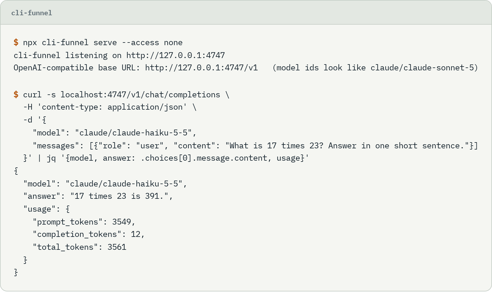
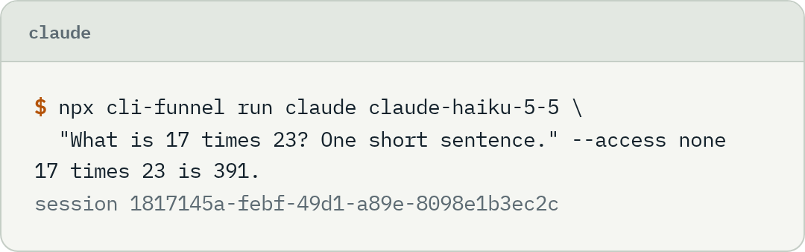
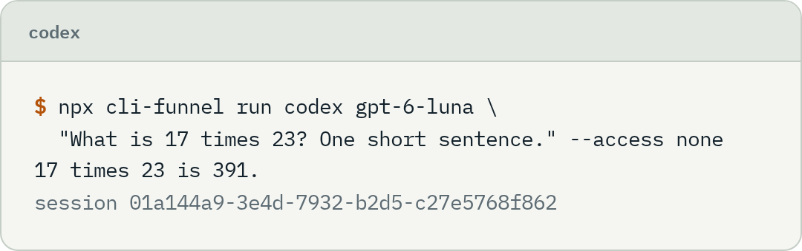

<p align="center">
  
</p>

<h1 align="center">cli-funnel</h1>

<p align="center">
  Use Claude Code, Codex, Cursor Agent and Antigravity like an API, on the subscription you already pay for.<br>
  Make the same call from TypeScript, the terminal or any OpenAI SDK, and get the same output whichever CLI answers.
</p>

<p align="center">
  <a href="https://github.com/SuperTost100/cli-funnel/releases/latest"></a>
  <a href="https://www.npmjs.com/package/cli-funnel"></a>
  <a href="https://github.com/SuperTost100/cli-funnel/actions/workflows/ci.yml"></a>
  <a href="LICENSE"></a>
</p>

<p align="center">
  <a href="#install">Install</a> ·
  <a href="#usage">Usage</a> ·
  <a href="#documentation">Documentation</a>
</p>

<picture>
  <source media="(prefers-color-scheme: dark)" srcset="docs/screenshots/serve-dark.png">
  
</picture>

## Why cli-funnel

Each of these CLIs runs headless, but every one has its own flags, its own event format, its own login command and its own way of listing models. If you want your app to work with all of them, you write four integrations and rewrite parts every time a CLI ships. cli-funnel is that work, done once and kept in one folder per CLI.

It starts the real binary. Your runs count against the login the CLI already has, not against an API bill. cli-funnel has no account, no telemetry and no server of its own. Your prompts go where they would go if you typed them into the CLI.

The same call also reaches the Anthropic, OpenAI and Gemini APIs with a key, a local Ollama, and any OpenAI-compatible server.

## What you can do

**Call any CLI the same way.** Every provider returns one event stream and one result shape. API-key providers return the same thing, so mixing keys and subscriptions needs no changes downstream. Switch `provider` to `codex`, `agent` or `antigravity` and nothing else in your code changes. Use `anthropic-api`, `openai-api` or `gemini-api` for a key, `ollama` for a local model, or `openai-compatible:<id>` for a server you configured.

**Pick the model and the limits in one object.** Model, reasoning effort, fast mode, project folder and access level live in a `Selection` that a UI produces or you hardcode. Model lists carry concrete versioned ids. There are no "latest" aliases, so a run always says which model it used. Local model servers are the exception: their ids are passed through as the server reports them.

**Sign in and update from your own UI.** Sign-in, sign-out and update pass through to each CLI. Your UI shows the sign-in link and a one-click update button. The CLI does the real work.

**Approve actions.** Supervised runs give you an approve step, where the CLI supports one.

**Serve it to any language.** `cli-funnel serve` is an OpenAI-compatible server. Point any OpenAI SDK at it.

**Build a picker.** `cli-funnel-react` has hooks, a model picker, a login panel and an approval prompt.

<table>
  <tr>
    <td width="50%">
      <picture>
        <source media="(prefers-color-scheme: dark)" srcset="docs/screenshots/run-claude-dark.png">
        
      </picture>
    </td>
    <td width="50%">
      <picture>
        <source media="(prefers-color-scheme: dark)" srcset="docs/screenshots/run-codex-dark.png">
        
      </picture>
    </td>
  </tr>
  <tr>
    <td>Claude Code answers through its own login.</td>
    <td>Codex gets the same command with a different provider and model.</td>
  </tr>
</table>

### What each CLI can do

| Feature                          | Claude Code | Codex | Cursor Agent  | Antigravity      |
| -------------------------------- | ----------- | ----- | ------------- | ---------------- |
| No tools (`none`)                | yes         | yes   | yes           | yes              |
| Supervised (approve each action) | yes         | yes   | no            | no               |
| Accept edits                     | yes         | yes   | no            | yes              |
| Auto                             | yes         | yes   | yes           | no               |
| Full access                      | yes         | yes   | yes           | yes              |
| Reasoning effort                 | yes         | yes   | yes           | yes              |
| Fast mode                        | no          | yes   | yes           | no               |
| Live model list                  | no, bundled | yes   | yes           | yes              |
| Resume a conversation            | yes         | yes   | yes           | yes              |
| System prompt                    | yes         | yes   | in the prompt | in the prompt    |
| Image input                      | yes         | yes   | no            | no               |
| JSON schema output               | yes         | yes   | in the prompt | yes              |
| Sign-in from your UI             | link        | link  | link          | terminal handoff |

Every "no" in this table is a limit of the CLI, not of cli-funnel. cli-funnel does not fake a feature. When a CLI cannot enforce something headlessly, the option is not offered. [Access levels](docs/access-levels.md) explains each gap.

Claude Code is the only CLI with a selectable context window. Models that run at 200k by default, such as `claude-opus-4-6`, offer a 1M variant, and the picker shows the choice for them. Newer Claude models already run at 1M.

## Install

You need Node 22 or newer and at least one CLI signed in.

```bash
npm install cli-funnel
npx cli-funnel doctor
```

`doctor` shows which CLIs it found, their versions, and whether you are signed in.

Apps started from the macOS Dock or a Linux desktop launcher get a minimal PATH. cli-funnel reads the PATH from your login shell once, searches it for the CLIs, and passes it to every CLI it starts, so tools installed through nvm, asdf, pnpm or Homebrew work from a GUI app. Set `CLI_FUNNEL_NO_SHELL_PATH=1` to skip that, or `CLI_FUNNEL_<BINARY>_BIN` to point at one binary directly.

## Usage

### From code

```ts
import { createFunnel } from "cli-funnel";

const funnel = createFunnel();

const result = await funnel.run({
  selection: {
    provider: "claude",
    model: "claude-sonnet-5",
    cwd: "/path/to/project",
    access: "accept-edits",
  },
  prompt: "Find the bug in src/parse.ts and fix it",
});

result.text;   // the answer
result.usage;  // { inputTokens, outputTokens, ... }
```

[Quickstart](docs/quickstart.md) covers streaming, picking a model and approving actions.

### From a terminal

```bash
npx cli-funnel models codex
npx cli-funnel run claude claude-sonnet-5 "Explain this repo" --access accept-edits
npx cli-funnel login codex
npx cli-funnel update claude
```

`run` takes `--system`, `--max-tokens` and `--session <id>`. It prints the session id on stderr. Pass that id to `--session` to continue the conversation. The CLIs keep their own sessions. For API providers and model servers, cli-funnel stores the history in `~/.local/state/cli-funnel/sessions`.

### From any language

Start the server, then point an OpenAI SDK at it. Model ids look like `<provider>/<model>`.

```bash
npx cli-funnel serve --cwd /path/to/project
```

```python
from openai import OpenAI

client = OpenAI(base_url="http://127.0.0.1:4747/v1", api_key="unused")
client.chat.completions.create(
    model="claude/claude-sonnet-5",
    messages=[{"role": "user", "content": "Explain src/main.py"}],
)
```

The server listens on `127.0.0.1:4747` and answers only requests from your own machine by default. [Run the server](docs/serve.md) covers hosts, folders, CORS and a Docker Compose setup for a tailnet.

### In a UI

The React components are a separate package:

```bash
npm install cli-funnel-react
```

```tsx
import { createClient } from "cli-funnel/client";
import { FunnelPicker, FunnelLogin, useProviders } from "cli-funnel-react";
import "cli-funnel-react/styles.css";

const client = createClient({ baseUrl: "/api/funnel" });

<FunnelPicker client={client} locked={{ access: "supervised" }} onChange={setSelection} />
```

`locked` hides a control and fixes its value, so the same component covers "let users choose" and "hardcode it". See [UI components](docs/ui.md).

## Configuration

Nothing is required. cli-funnel reads no `.env` file, so set these in the environment of the process that starts it. [`deploy/compose.env.example`](deploy/compose.env.example) lists the two that the Docker Compose setup needs.

| Variable                       | Default                    | What it does                                                                                      |
| ------------------------------ | -------------------------- | ------------------------------------------------------------------------------------------------- |
| `CLI_FUNNEL_TOKEN`             | none                       | Token the server requires as `Authorization: Bearer <token>`. Needed to bind past localhost.      |
| `CLI_FUNNEL_ALLOWED_HOSTS`     | localhost and IP addresses | Extra host names the server accepts, comma-separated. `.example.com` matches subdomains.          |
| `CLI_FUNNEL_OPENAI_COMPATIBLE` | none                       | JSON list of OpenAI-compatible servers, such as LM Studio. Each becomes `openai-compatible:<id>`. |
| `CLI_FUNNEL_NO_SHELL_PATH`     | off                        | Set to `1` to skip reading the PATH from your login shell.                                        |
| `CLI_FUNNEL_<BINARY>_BIN`      | found on the PATH          | Path to one CLI. `<BINARY>` is `CLAUDE`, `CODEX`, `AGENT` or `AGY`.                               |

The flags and the config file for `serve` are in [Run the server](docs/serve.md).

## Build from source

You need Node 22 or newer and npm.

```bash
git clone https://github.com/SuperTost100/cli-funnel.git
cd cli-funnel
npm ci          # installs every package in the workspace
npm run build   # builds cli-funnel, cli-funnel-react and the playground
```

The checks CI runs, on Node 22 and 24:

```bash
npm run typecheck
npm test                # unit tests against recorded CLI output, no logins needed
```

`CLI_FUNNEL_LIVE=1 npm test` also runs the live tests against your installed CLIs. They spend a few tokens. [Keeping up with CLI changes](docs/maintenance.md) explains how to add a model or follow a changed flag. `npm run playground` starts a test bench for the React components.

## Documentation

| Read this                                                  | To learn                                                             |
| ---------------------------------------------------------- | -------------------------------------------------------------------- |
| [Quickstart](docs/quickstart.md)                           | Install, run, stream and approvals                                   |
| [Concepts](docs/concepts.md)                               | What cli-funnel does and how its parts fit together                  |
| [Selection](docs/selection.md)                             | The settings object, model lists and validation                      |
| [Access levels](docs/access-levels.md)                     | What each CLI can enforce                                            |
| [Run options](docs/run-options.md)                         | System prompt, images, JSON answers and the output limit             |
| [Live sessions](docs/sessions.md)                          | Keep Claude Code and Codex running between turns, steer and fork     |
| [Sign-in and updates](docs/auth-and-updates.md)            | Passing login and update through to each CLI                         |
| [UI components](docs/ui.md)                                | Hooks, picker, login panel and approvals                             |
| [Run the server](docs/serve.md)                            | Config file, folders, CORS, run log, Docker Compose and systemd      |
| [OpenAI compatibility](docs/openai-compat.md)              | The `/v1` endpoints, model ids, mapping and limits                   |
| [API keys](docs/api-keys.md)                               | The Anthropic, OpenAI and Gemini providers that use a key            |
| [MCP server](docs/mcp.md)                                  | Call a provider as a tool from Claude Code, Codex or Cursor          |
| [Providers](docs/providers/claude.md)                      | One page per provider, from Claude Code to OpenAI-compatible servers |
| [Adding a provider](docs/adding-a-provider.md)             | What a new provider has to implement                                 |
| [Keeping up with CLI changes](docs/maintenance.md)         | New models, changed flags and the nightly check                      |
| [Terms and limits](docs/tos-notes.md)                      | What provider terms mean for a product built on a subscription       |
| [Integrating with an AI assistant](docs/ai-integration.md) | Ordered steps with a check for each, plus `llms.txt` and `AGENTS.md` |

## Known limits

Runs inherit the user's own CLI setup. Claude Code loads the user's CLAUDE.md, hooks and skills, so a one-line prompt can cost about 20k input tokens. Access `none` skips all of that on Claude Code and cuts most of it on Codex. On Cursor Agent and Antigravity it blocks every tool but saves no tokens. Cursor Agent follows the user's Cursor approval settings, and cli-funnel always passes an explicit approval flag so those settings cannot silently widen access.

Fast mode on Claude Code is off because the CLI does not enable it headlessly. The fable model needs usage credits on a Pro plan.

Sign-in, sign-out and update are written from each CLI's own help output and covered by unit tests. They have not been run against a signed-out account yet, so treat the first real login on each CLI as a test.

Provider terms decide what you may build on a subscription. Read [Terms and limits](docs/tos-notes.md) before you ship a product.

## How it stays current

Each CLI lives in one folder. Parsers are pure functions tested against recorded real output. A nightly job installs the newest CLIs and checks that every flag we use still exists, and opens an issue if one is gone. The steps for a new model or a changed flag are in [Keeping up with CLI changes](docs/maintenance.md).

## License

cli-funnel is MIT licensed. See [LICENSE](LICENSE).
